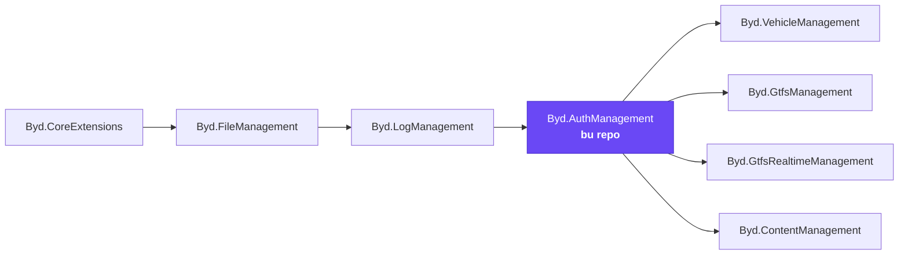
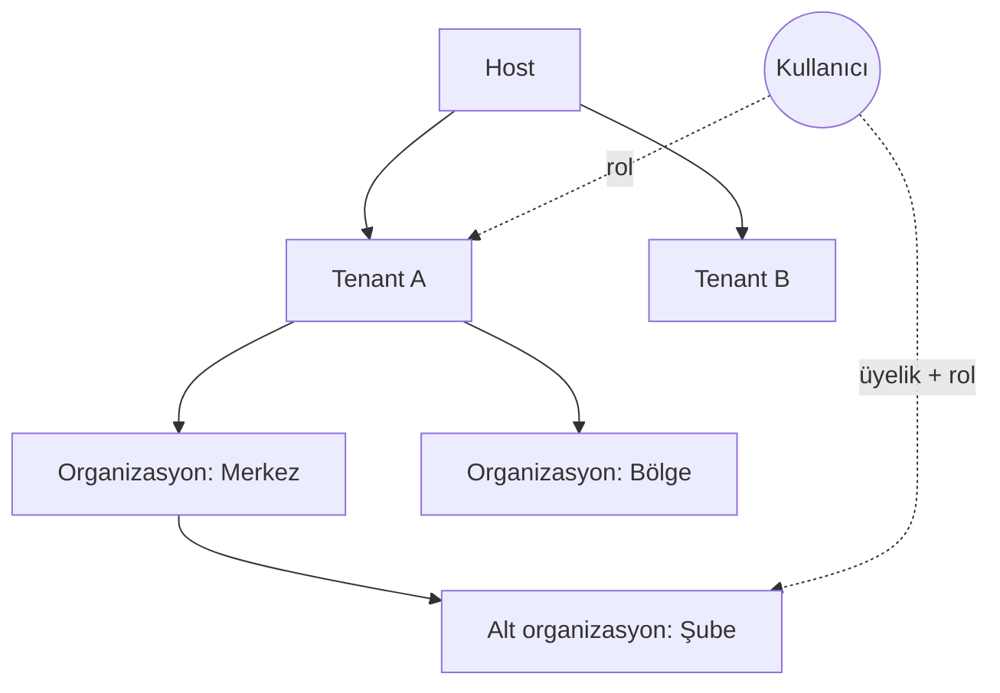
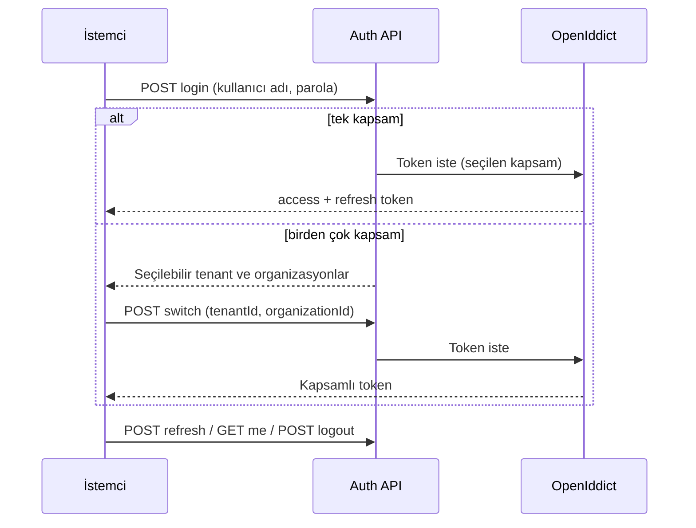
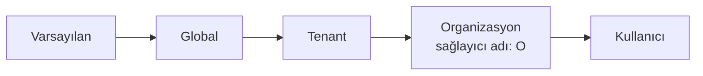

# Byd.AuthManagement

[](https://www.nuget.org/packages/Byd.AuthManagement.Domain)


Platformun kimlik modülü. Kullanıcıları, tenant'ları, organizasyonları, rolleri, izinleri, feature değerlerini ve token
sunucusunu tek başına taşır. Giriş, kapsam seçimi, kayıt, davet ve şifre işlemleri buradan yapılır. Diğer modüller bu
bilgileri saklamaz: kendi izinlerini tanımlar, token'ı bu modüle karşı doğrular ve izinleri ortak veritabanındaki auth
tablolarından okur.

## İçindekiler

- [Platformdaki yeri](#platformdaki-yeri)
- [Bir bakışta](#bir-bakışta)
- [Kapsam modeli](#kapsam-modeli)
- [Özellikler](#özellikler)
- [HTTP uçları](#http-uçları)
- [Veritabanı](#veritabanı)
- [Yetkiler](#yetkiler)
- [Hata kodları](#hata-kodları)
- [Bir modülde kullanmak](#bir-modülde-kullanmak)
- [Geliştirme](#geliştirme)

## Platformdaki yeri

Auth zincirin en üst platform modülüdür. Onu alan bir proje log, file ve core'u da birlikte alır.



## Bir bakışta

| | |
|---|---|
| Paket ailesi | `Byd.AuthManagement.*` |
| Sürüm | `0.1.10` (`common.props`) |
| Bağımlılık | `Byd.LogManagement` 0.1.7 (o da file ve core'u getirir) |
| Token sunucusu | OpenIddict (yalnız auth host'unda çalışır) |
| Veritabanı | PostgreSQL, `auth_management` şeması; ABP identity, tenant, OpenIddict, izin ve feature tabloları da burada |
| Bağlantı dizesi | `AuthManagement`; tanımlı değilse `Default` |

## Kapsam modeli

Kullanıcı bir host kaydıdır ve birden çok tenant'ta, bir tenant içinde birden çok organizasyonda rol taşıyabilir.
Organizasyonlar ABP organization unit'leridir ve ağaç oluşturur. Token her zaman seçilen tek bir kapsam için üretilir;
roller o kapsama indirgenir.



Token'a yazılan kapsam claim'leri:

| Claim | Ne taşır |
|---|---|
| `tenant_id`, `tenant_name` | Seçilen tenant |
| `organization_id`, `organization_name` | Seçilen organizasyon |
| `parent_organization_id`, `parent_organization_name` | Üst organizasyon |
| `scope_level` | Seçilen kapsamın seviyesi |

Core'un organizasyon ara katmanı bu claim'leri okur ve her modülde `ICurrentOrganization`'ı kurar.

## Özellikler

### 1. Giriş ve kapsam seçimi



Giriş yalnız kullanıcının rol taşıdığı kapsamları sunar. Oturum açıkken `switch` ile başka bir tenant ya da organizasyona
geçilir; `me` kullanıcının kimliğini, kapsamını, rollerini ve üyeliklerini döner.

### 2. Kayıt

| Uç | Ne yapar |
|---|---|
| `register` | Kullanıcıyı sistemdeki aktif tenant'a ve o tenant'ın varsayılan rollerine kaydeder |
| `register-tenant` | Yeni tenant açar, tenant tarafındaki bütün izinleri taşıyan bir `admin` rolü kurar ve kullanıcıyı bu role koyar; kullanıcı hemen giriş yapabilir. Organizasyon açmaz |

Kullanıcı adı, e-posta ve tenant adı sistem genelinde tekildir.

### 3. Davet

`invite-user` kullanıcıyı verilen rollerle davet eder. E-posta kayıtlıysa mevcut kullanıcıya roller eklenir; değilse
kullanıcı şifresiz açılır ve şifre belirleme bağlantısı e-postasına gider. Davet edenin yetkisi kapsamıyla sınırlıdır:
organizasyon yöneticisi yalnız kendi organizasyonu ve alt ağacının rollerini verebilir. E-posta core'un şablonlarıyla
gider; `AuthManagement.UserInvitation` olayı ve Türkçe/İngilizce host şablonu seed edilir.

### 4. Şifre işlemleri

| Uç | Ne yapar |
|---|---|
| `send-password-reset-code` | Sıfırlama bağlantısını e-postaya gönderir |
| `verify-password-reset-token` | Bağlantıdaki token hâlâ geçerli mi |
| `reset-password` | Token'la yeni şifreyi belirler |
| `change-password` | Giriş yapmış kullanıcının şifresini değiştirir |

Bağlantı, istemci uygulamanın `account/reset-password` sayfasına gider; adresi host `AppUrlOptions` ile verir.

### 5. Organizasyon ağacı

Organizasyon açılırken bir yönetici kullanıcı (yeni ya da mevcut) ve organizasyona özel feature değerleri verilir. Ağaç
okuma, taşıma, alt ağacıyla silme ve üyelik işlemleri `organizations` uçlarındadır. Üyelik değişikliği kullanıcının bir
sonraki giriş ya da yenilemesinde token'a yansır.

### 6. Organizasyon bazında ayar ve feature

ABP'nin sağlayıcı zincirine organizasyon katmanı eklenir. Bir modül kendi ayarını ya da feature'ını her zamanki gibi okur;
yürürlükteki organizasyon için bir değer varsa o gelir.



Organizasyon feature'larını yönetmek `AuthManagement.Features.Manage` izni ister.

### 7. Diğer modüllerin izinleri

Her modül host'u kendi izin tanımlarını açılışta auth tablolarına yazar; rol ve kullanıcı izinleri auth üzerinden yönetilir.
Tüketen modül host'ları izinleri, feature değerlerini, tenant'ları ve kullanıcıları ortak veritabanından okur.

## HTTP uçları

**`api/auth-management/account`**

| Yöntem | Yol | Ne yapar |
|---|---|---|
| `POST` | `login` | Giriş; gerekirse seçilebilir kapsamları döner |
| `POST` | `switch` | Tenant ve organizasyon seçer ya da değiştirir |
| `POST` | `refresh` | Refresh token ile yeni token |
| `GET` | `me` | Kimlik, kapsam, roller, üyelikler |
| `POST` | `logout` | Oturumu kapatır |
| `POST` | `register` | Aktif tenant'a kullanıcı kaydı |
| `POST` | `register-tenant` | Tenant ve sahibini açar |
| `POST` | `invite-user` | Kullanıcıyı rollerle davet eder |
| `POST` | `send-password-reset-code` | Sıfırlama bağlantısı gönderir |
| `POST` | `verify-password-reset-token` | Token geçerli mi |
| `POST` | `reset-password` | Yeni şifreyi belirler |
| `POST` | `change-password` | Şifreyi değiştirir |

**`api/auth-management/organizations`**

| Yöntem | Yol | Ne yapar |
|---|---|---|
| `GET` | `{id}` | Tek organizasyon |
| `GET` | `roots` | Üst organizasyonu olmayanlar |
| `GET` | `{id}/children` | Doğrudan alt organizasyonlar |
| `GET` | `tenants/{tenantId}` | Tenant'ın bütün organizasyonları |
| `GET` | `tenants/{tenantId}/roots` | Tenant'ın kök organizasyonları |
| `GET` | `tenants/{tenantId}/tree` | Ağaç sırasında liste |
| `GET` | `tenants/{tenantId}/users/{userId}` | Kullanıcının tenant içindeki üyelikleri |
| `POST` | `/` | Yeni organizasyon (yönetici ve feature'larla) |
| `PUT` | `{id}` | Ad ve ağaçtaki yer |
| `DELETE` | `{id}` | Alt ağacıyla siler |
| `POST` | `{id}/members/{userId}` | Üye ekler |
| `DELETE` | `{id}/members/{userId}` | Üyeliği kaldırır |

## Veritabanı

Modül kendi entity'sini tanımlamaz; ABP'nin hazır modüllerinin tablolarını `auth_management` şemasına taşır.

| Tablo grubu | Ne tutar |
|---|---|
| Identity (`Users`, `Roles`, `UserRoles`, `OrganizationUnits`, `UserOrganizationUnits`, `OrganizationUnitRoles`, ...) | Kullanıcılar, roller, organizasyon ağacı ve üyelikler |
| Tenant (`Tenants`, `TenantConnectionStrings`) | Kiracılar |
| İzin (`Permissions`, `PermissionGroups`, `PermissionGrants`) | Bütün modüllerin izin tanımları ve verilen izinler |
| Feature (`Features`, `FeatureGroups`, `FeatureValues`) | Feature tanımları ve tenant/organizasyon değerleri |
| OpenIddict (`OpenIddictApplications`, `OpenIddictScopes`, `OpenIddictTokens`, `OpenIddictAuthorizations`) | Token sunucusu kayıtları |

Rol tablosunda organizasyon sütunu yoktur; organizasyon kapsamı organization unit bağ tablolarından gelir.

## Yetkiler

| İzin | Ne verir |
|---|---|
| `AuthManagement.Users.Manage` | Kullanıcı davet etmek |
| `AuthManagement.Organizations.View` / `.Manage` | Organizasyonları görmek / yönetmek |
| `AuthManagement.Features.Manage` | Organizasyon feature değerlerini yönetmek |

## Hata kodları

| Aile | Kapsadığı durumlar |
|---|---|
| `LoginExceptionCodes` | Hatalı kimlik, kilitli hesap, kapsam yok, kapsamda rol yok, token isteği başarısız |
| `RegistrationExceptionCodes` | Tenant yok, varsayılan rol yok, organizasyon kayda kapalı, eksik alanlar |
| `InvitationExceptionCodes` | Rol verilemez, rol birden çok organizasyona bağlı, eksik alanlar |
| `PasswordExceptionCodes` | Eksik alanlar, yeni şifre eskisiyle aynı |
| `OrganizationExceptionCodes` | Ad eksik/uzun, yönetici bilgileri eksik, kapsam dışı |
| `FeatureExceptionCodes` | Tanımsız feature, geçersiz değer, tekrarlı ad, kapsam dışı |

Kodlar `AuthManagement:` önekiyle gelir.

## Bir modülde kullanmak

Platform şablonundan üretilen bir modülde bu bağlantı hazır gelir.

| Tüketen katman | Paket | Modül sınıfı |
|---|---|---|
| `<Modül>.Domain.Shared` | `Byd.AuthManagement.Domain.Shared` | `AuthManagementDomainSharedModule` |
| `<Modül>.Domain` | `Byd.AuthManagement.Domain` | `AuthManagementDomainModule` |
| `<Modül>.Application.Contracts` | `Byd.AuthManagement.Application.Contracts` | `AuthManagementApplicationContractsModule` |
| `<Modül>.EntityFrameworkCore` | `Byd.AuthManagement.EntityFrameworkCore` | `AuthManagementEntityFrameworkCoreModule` |

Tüketen modül auth'un `Application` ve `HttpApi` paketlerini almaz; alırsa ikinci bir token sunucusu ve hesap uçları açılır.

**Tüketen host**

```json
{
  "AuthServer": {
    "Authority": "https://localhost:44323",
    "Audience": "AuthManagement",
    "RequireHttpsMetadata": true
  },
  "ConnectionStrings": {
    "Default": "<modülün veritabanı>",
    "AuthManagement": "<auth veritabanı; aynıysa yazılmayabilir>"
  }
}
```

Token `AddAbpJwtBearer` ile doğrulanır; pipeline'da `UseAuthentication()` ve çok kiracılıysa `UseMultiTenancy()` yeterlidir.

**Auth host'u**

| Gereken | Neden |
|---|---|
| `AuthManagementModuleOptions.Authority` | Giriş servisi token'ı bu adresteki token ucundan ister |
| `AppUrlOptions` (`Web` uygulaması) | Şifre ve davet bağlantılarının kök adresi |
| `Abp.Mailing.*` | SMTP ayarları (core'un sözleşmesi) |

```csharp
app.UseAuthentication();
app.UseAbpOpenIddictValidation();
app.UseCoreExtensions();
app.UseFileManagement();
app.UseAuthorization();
app.UseAuditing();
```

## Geliştirme

```bash
dotnet build Byd.AuthManagement.slnx
dotnet test Byd.AuthManagement.slnx
```

Host `host/Byd.AuthManagement.HttpApi.Host` altındadır. `dotnet ef` komutları `AuthManagement` bağlantı dizesini okur;
ayarda tanımlı olmalıdır.
