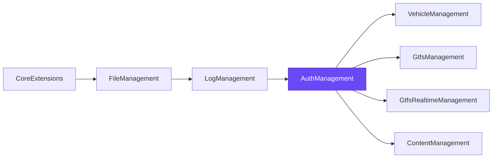
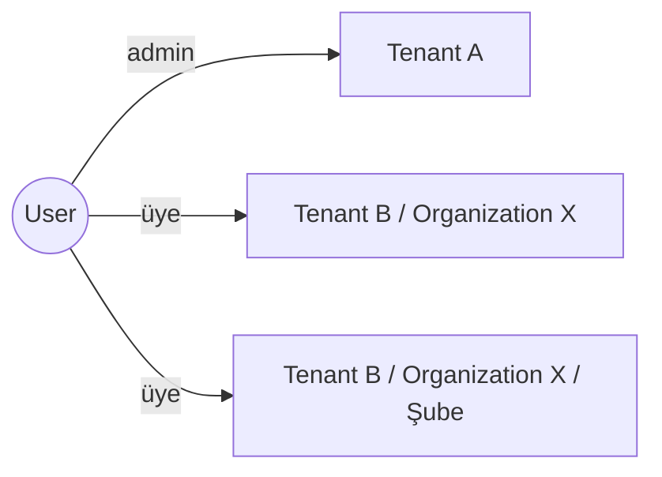
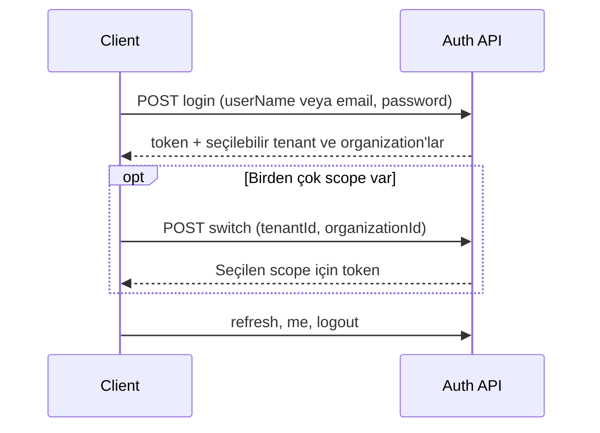
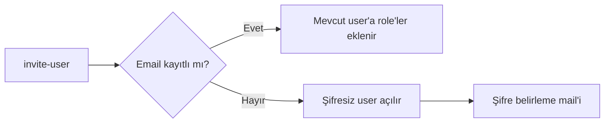
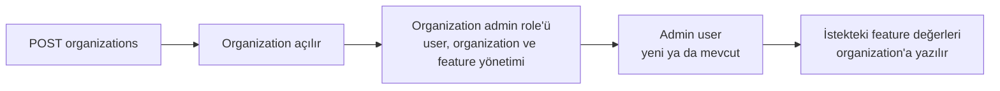
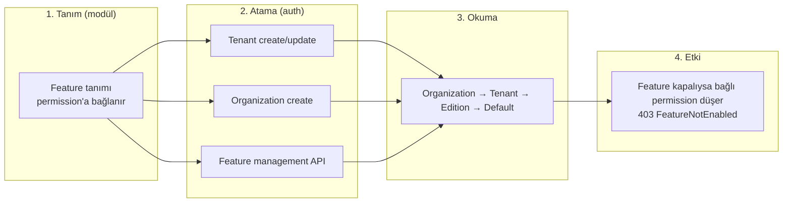
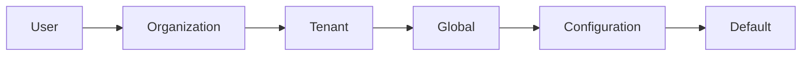

# Byd.AuthManagement

Platformun identity ve authorization modülü. User, tenant, organization, role, permission, feature ve setting yönetimi
burada toplanır; OpenIddict token server'ı da bu modülde çalışır. Diğer modüller user ya da role tutmaz: token'ı auth'a
karşı validate eder, permission ve feature değerlerini ortak database'deki auth tablolarından okur.



## Capabilities

| Capability | Ne sağlar |
|---|---|
| [Login ve scope seçimi](#login-ve-scope-seçimi) | Tek login; user'ın girebildiği tenant ve organization'lar arasında seçim, seçilen scope için token |
| [Register](#register) | Mevcut tenant'a user kaydı ya da yeni tenant ve sahibini açma |
| [Invite](#invite) | User'ı role'leriyle davet etme, şifre belirleme mail'i |
| [Password](#password) | Reset link, reset ve change password |
| [Organization tree](#organization-tree) | Tenant içinde hiyerarşik organization'lar, her biri kendi admin'iyle |
| [Feature management](#feature-management) | Bir capability'yi tenant ya da organization bazında açıp kapatma |
| [Organization settings](#organization-settings) | Bir setting'in değerini organization bazında değiştirme |
| [Merkezi permission yönetimi](#merkezi-permission-yönetimi) | Bütün modüllerin permission'ları tek yerden verilir |
| [SuperAdmin](#superadmin) | Temiz database'de ilk host yöneticisi |

## Login ve scope seçimi

User host seviyesinde tek kayıttır ve birden çok tenant'ta, organization'da role taşıyabilir. Token ise her zaman tek bir
scope için üretilir; user'ın role'leri o scope'a indirgenir. Aynı user bir tenant'ta admin, başka bir organization'da
sadece üye olabilir.



Login bu scope'ları listeler. Tek scope varsa token hemen o scope için çıkar; birden çok varsa client `switch` ile seçer.
Oturum açıkken başka bir scope'a geçmek için şifre tekrar istenmez.



| Seçilen scope | Token'daki `scope_level` |
|---|---|
| Host (tenant yok) | `SuperAdmin` |
| Tenant | `Tenant` |
| Kök organization | `Organization` |
| Alt organization | `SubOrganization` |

Token `tenant_id`, `organization_id`, `parent_organization_id` ve `scope_level` claim'lerini taşır. Core'un middleware'i
bu claim'lerden her modülde `ICurrentOrganization`'ı doldurur; organization'a bağlı data o scope'a göre filtrelenir.

## Register

| Endpoint | Ne yapar |
|---|---|
| `POST account/register` | User'ı açar ve sistemdeki aktif tenant'ın default role'lerini verir |
| `POST account/register-tenant` | Yeni tenant açar, tenant'ın bütün permission'larını taşıyan `admin` role'ünü kurar ve user'ı bu role koyar |

UserName, email ve tenant adı sistem genelinde unique'tir. `register-tenant` organization ya da feature seçimi almaz;
yeni tenant'ın feature'ları default değerleriyle başlar.

## Invite

`POST account/invite-user` bir user'ı verilen role'lerle davet eder. Tenant ve organization ayrıca seçilmez, role'lerden
çıkar. Davet eden kendi scope'u dışındaki role'ü veremez: organization admin'i yalnız kendi organization'ının ve alt
ağacının role'lerini verebilir.



Mail core'un email template sistemiyle gider. `AuthManagement.UserInvitation` email event'i ve Türkçe, İngilizce
template'leri seed edilir; tenant ya da organization kendi template'ini yazabilir. Link'in adresi istekteki `appName`
ile host'un `AppUrlOptions` ayarından kurulur.

## Password

| Endpoint | Ne yapar |
|---|---|
| `send-password-reset-code` | Reset link'ini user'ın email'ine gönderir |
| `verify-password-reset-token` | Link'teki token hâlâ geçerli mi |
| `reset-password` | Token'la yeni şifreyi belirler |
| `change-password` | Login olmuş user'ın şifresini değiştirir |

## Organization tree

Organization'lar tenant içinde bir ağaç oluşturur (ABP OrganizationUnit). Bir organization açıldığında admin'iyle
birlikte kullanıma hazır hale gelir:



- **Scope kuralı:** organization scope'undaki bir admin yalnız kendi alt ağacında organization açar, taşır, siler ve üye
  ekler. Başka bir tenant'ın organization'ına dokunulamaz.
- **Silme:** organization alt ağacıyla birlikte silinir; role'leri ve feature değerleri de temizlenir.
- **Üyelik:** üye ekleme ve çıkarma, user'ın bir sonraki login ya da refresh'inde token'a yansır.

| | Endpoint'ler (`api/auth-management/organizations`) |
|---|---|
| Okuma | `{id}`, `roots`, `{id}/children`, `tenants/{tenantId}`, `tenants/{tenantId}/roots`, `tenants/{tenantId}/tree`, `tenants/{tenantId}/users/{userId}` |
| Yazma | `POST /`, `PUT {id}`, `DELETE {id}`, `POST` ve `DELETE {id}/members/{userId}` |

## Feature management

Permission "bu user bunu yapabilir mi" sorusunu cevaplar; feature ise "bu tenant ya da organization bu capability'yi
kullanabilir mi" sorusunu. Bir modül, paket ya da plan bazında satılan bir yeteneği feature'a bağlar; auth o feature'ı
tenant ya da organization bazında açıp kapatır. Feature bir toggle olabileceği gibi limit gibi bir değer de taşıyabilir.



**Nerede atanır**

| Nerede | Kime | Gereken permission |
|---|---|---|
| Tenant create/update (`api/multi-tenancy/tenants`, `extraProperties.Features`) | Tenant | `AbpTenantManagement.Tenants.ManageFeatures` |
| Organization create (`features` listesi) | Organization | `AuthManagement.Organizations.Manage` |
| `api/feature-management/features?providerName=O&providerKey={organizationId}` | Organization | `AuthManagement.Features.Manage` |
| `api/feature-management/features?providerName=T&providerKey={tenantId}` | Tenant | `AbpTenantManagement.Tenants.ManageFeatures` |

**Nasıl çalışır**

- Bir modülün feature okuması değişmez (`IFeatureChecker`, `[RequiresFeature]` ya da permission'daki `RequireFeatures`).
  Aktif organization için değer varsa o gelir; yoksa tenant'ın değerine, o da yoksa default'a düşer.
- Liste gönderildiğinde scope'un override'ları bu listeyle eşitlenir; listede olmayan feature default'a döner. Liste hiç
  gönderilmezse mevcut değerlere dokunulmaz.
- Tanımsız feature adı ya da tipine uymayan değer reddedilir.
- Organization feature'ı yalnız aynı tenant'tan ve kendi alt ağacından yönetilir.
- Feature tanımları dynamic store'da tutulur; bir modülün tanımladığı feature auth'ta da görünür ve atanabilir.
- Host scope'undaki SuperAdmin için bütün toggle feature'lar açık kabul edilir; sayısal değerler yine zincirden okunur.
- Bir permission feature kapalı olduğu için reddedilirse core 403'ü `FeatureNotEnabled` koduyla ve feature'ın adıyla döner.

```csharp
// Modülde örnek: feature tanımı ve feature'a bağlı permission
group.AddFeature("Reporting.Export", defaultValue: "false", valueType: new ToggleStringValueType());

reports.AddChild(ReportingPermissions.Reports.Export)
    .RequireFeatures("Reporting.Export");
```

## Organization settings

ABP setting zincirine organization seviyesi eklenir. Modül setting'ini her zamanki gibi `ISettingProvider` ile okur;
aktif organization için değer yazılmışsa o gelir.



Değer `ISettingManager.SetAsync(name, value, "O", organizationId)` ile yazılır. Organization değeri yoksa okuma tenant'a,
oradan global ve default değere düşer.

## Merkezi permission yönetimi

Her modül host'u kendi permission tanımlarını açılışta auth tablolarına yazar. Role ve user permission'ları ABP'nin
`api/permission-management/permissions` endpoint'iyle auth üzerinden verilir; tüketen modüller permission'ı ortak
database'den okur. Auth'un kendi permission'ları:

| Permission | Ne verir |
|---|---|
| `AuthManagement.Users.Manage` | User davet etmek |
| `AuthManagement.Organizations.View` / `.Manage` | Organization'ları görmek / yönetmek |
| `AuthManagement.Features.Manage` | Organization feature'larını yönetmek |

## SuperAdmin

Host config'inde `AuthServer:SuperAdminUserName`, `AuthServer:SuperAdminEmail` ve `AuthServer:SuperAdminPassword`
doluysa seed `SuperAdmin` role'ünü açar, host permission'larının hepsini bu role verir ve user'ı bağlar. Seed tekrar
çalıştırılabilir. Config eksikse hiçbir hesap açılmaz; default bir şifre yoktur.

## Modülde kullanım

Platform template'inden üretilen modülde bu bağlantı hazır gelir.

| Katman | Paket |
|---|---|
| `Domain.Shared` | `Byd.AuthManagement.Domain.Shared` |
| `Domain` | `Byd.AuthManagement.Domain` |
| `Application.Contracts` | `Byd.AuthManagement.Application.Contracts` |
| `EntityFrameworkCore` | `Byd.AuthManagement.EntityFrameworkCore` |

Tüketen modül auth'un `Application` ve `HttpApi` paketlerini almaz; alırsa ikinci bir token server ve account
endpoint'leri açılır. Tüketen host token'ı auth'a karşı validate eder:

```json
{
  "AuthServer": {
    "Authority": "https://localhost:44323",
    "Audience": "AuthManagement",
    "RequireHttpsMetadata": true
  }
}
```

## Geliştirme

```bash
dotnet build Byd.AuthManagement.slnx
dotnet test Byd.AuthManagement.slnx
```

Host `host/Byd.AuthManagement.HttpApi.Host` altındadır.
